<a href="https://readme-typing-svg.demolab.com/?font=Fira+Code&size=22&duration=2800&pause=900&color=A78BFA&center=true&vCenter=true&width=850&lines=Full-Stack+Web+Developer;Building+Clean+Interfaces+%26+Practical+Web+Applications;React+%7C+Next.js+%7C+Node.js+%7C+Express;MySQL+%7C+JWT+%7C+Modern+UI;Based+in+Dhaka%2C+Bangladesh">
  
</a>

<picture>
  <source media="(prefers-color-scheme: dark)" srcset="./Irfan_Haider_Abir_dark_.svg">
  <source media="(prefers-color-scheme: light)" srcset="./Irfan_Haider_Abir_light_.svg">
  
</picture>

<div align="center">

<picture>
  <source
    media="(prefers-color-scheme: dark)"
    srcset="https://github-readme-streak-stats-eight.vercel.app/?user=iRfANhAiDeRABiR&hide_border=true&background=0A101F&stroke=22D3EE&ring=A78BFA&fire=10B981&currStreakLabel=22D3EE&sideLabels=94A3B8&currStreakNum=F8FAFC&sideNums=F8FAFC&dates=64748B&titleColor=22D3EE&card_width=1180"
  />
  <source
    media="(prefers-color-scheme: light)"
    srcset="https://github-readme-streak-stats-eight.vercel.app/?user=iRfANhAiDeRABiR&hide_border=true&background=FFFFFF&stroke=7C3AED&ring=6D28D9&fire=10B981&currStreakLabel=0F172A&sideLabels=475569&currStreakNum=0F172A&sideNums=0F172A&dates=64748B&titleColor=7C3AED&card_width=1180"
  />
  
</picture>

</div>

<picture>
  <source
    media="(prefers-color-scheme: dark)"
    srcset="https://github-profile-summary-cards.vercel.app/api/cards/stats?username=iRfANhAiDeRABiR&theme=github_dark"/>
  <source
    media="(prefers-color-scheme: light)"
    srcset="https://github-profile-summary-cards.vercel.app/api/cards/stats?username=iRfANhAiDeRABiR&theme=github_default"/>
  
</picture>

<picture>
  <source
    media="(prefers-color-scheme: dark)"
    srcset="https://github-profile-summary-cards.vercel.app/api/cards/most-commit-language?username=iRfANhAiDeRABiR&theme=github_dark"/>
  <source
    media="(prefers-color-scheme: light)"
    srcset="https://github-profile-summary-cards.vercel.app/api/cards/most-commit-language?username=iRfANhAiDeRABiR&theme=github_default"/>
  
</picture>

<div align="center">
<a href="https://github.com/iRfANhAiDeRABiR">

</a>
&nbsp;&nbsp;

&nbsp;&nbsp;

</div>

---

<div align="center">

<a href="https://iabir.me">

</a>
&nbsp;&nbsp;
<a href="https://www.linkedin.com/in/irfan-haider-abir">

</a>

</div>

---

<div align="center">



</div>

---

## About

I am a **Full-Stack Web Developer** from **Dhaka, Bangladesh**, focused on building modern web applications with **JavaScript**.

I like turning ideas into working products, learning new technologies through projects, and improving the small details that make software easier to use. My work covers **frontend interfaces, backend APIs, and database-driven applications**.

### Engineering Focus

* Full-Stack Web Development
* Modern frontend with React and Next.js
* Backend APIs with Node.js and Express
* Database design with MySQL
* Authentication with JWT
* Clean, responsive user interfaces
* Deployment, APIs and architecture for real products

### Open To

**Full-Stack Development • Frontend Development • Backend Development • Open Source Collaboration**

---

## Tech Stack

### Languages

<p>

</p>

### Frontend

<p>

</p>

### Backend & Databases

<p>

</p>

### Tools

<p>

</p>

---

## Featured Projects

<details>
<summary><strong>01 · Healthcare Service</strong></summary>

<br/>

A full-stack healthcare platform connecting users with hospitals, diagnostics, blood banks, pharmacies, ambulance support and telemedicine.

| Dimension       | Details                                                         |
| --------------- | --------------------------------------------------------------- |
| **Stack**       | React • Vite • Node.js • Express • MySQL • JWT                  |
| **Scale**       | Full-stack healthcare service platform                          |
| **Impact**      | Brings several healthcare services together in one application  |
| **Repository**  | [View on GitHub](https://github.com/iRfANhAiDeRABiR/Healthcare-react) |

### Engineering Perspective

The project combines a **React frontend** with a **Node.js and Express API**, using **MySQL** for persistent data and **JWT** for authentication.

</details>

<br/>

<details>
<summary><strong>02 · Meritloom — Mastery Learning Platform</strong></summary>

<br/>

A modern learning platform focused on structured learning, progress tracking, and a clean student experience.

| Dimension       | Details                                                                        |
| --------------- | ------------------------------------------------------------------------------ |
| **Stack**       | Next.js • React • TypeScript                                                   |
| **Focus**       | Structured learning and progress tracking                                      |
| **Impact**      | Delivers a clean, focused experience for students                              |
| **Repository**  | [View on GitHub](https://github.com/iRfANhAiDeRABiR/Meritloom--Mastery-Learning-Platform) |

### Engineering Perspective

The project applies **modern UI practices** and a component-based **Next.js** architecture to a learning-focused product.

</details>

<br/>

<details>
<summary><strong>03 · UIU UCAM Course Evaluation Automator</strong></summary>

<br/>

A Chrome and Firefox extension that automates course evaluations on the UIU UCAM portal, with one-click evaluation from an active session and a per-course checklist.

| Dimension       | Details                                                                                      |
| --------------- | -------------------------------------------------------------------------------------------- |
| **Stack**       | JavaScript • Manifest V3 • Browser Extension APIs                                            |
| **Scale**       | Browser extension packaged for Chrome and Firefox (v1.0.2)                                   |
| **Impact**      | Automates a repetitive university workflow, with live progress and logs                      |
| **Security**    | Runs client-side on the UCAM domain, minimal permissions, credentials cleared after login    |
| **Repository**  | [View on GitHub](https://github.com/iRfANhAiDeRABiR/UIU-Course-Evaluation-Tool)              |

### Engineering Perspective

The project shows how a browser extension can automate a multi-step web form safely, using **content scripts**, **background workers**, and **DOM-safe rendering**, with separate builds for **Chrome** and **Firefox**.

</details>

---

## Right Now

```text
⚡ Building → full-stack products
🧠 Learning → Next.js, TypeScript & scalable architecture
🎨 Refining → UI/UX + architecture
🛠 Exploring → APIs, databases, auth & deployment
```

---

<div align="center">

### `Build it. Learn it. Improve it. Repeat.`

<br/>


</div>