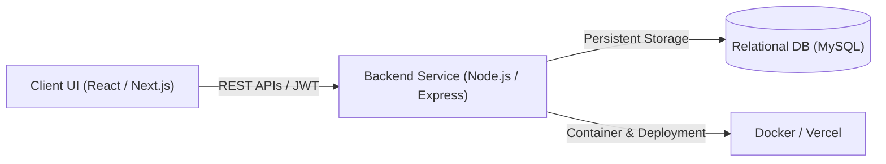

<div align="center">

<a href="https://readme-typing-svg.demolab.com/?font=Fira+Code&size=22&duration=2800&pause=900&color=A78BFA&center=true&vCenter=true&width=850&lines=Full-Stack+Web+Developer;Building+Clean+Interfaces+%26+Practical+Web+Applications;React+%7C+Next.js+%7C+Node.js+%7C+Express;MySQL+%7C+JWT+%7C+Modern+UI;Based+in+Dhaka%2C+Bangladesh">
  
</a>

<picture>
  <source media="(prefers-color-scheme: dark)" srcset="https://raw.githubusercontent.com/iRfANhAiDeRABiR/iRfANhAiDeRABiR/assets-header/Irfan_Haider_Abir_dark_.svg">
  <source media="(prefers-color-scheme: light)" srcset="https://raw.githubusercontent.com/iRfANhAiDeRABiR/iRfANhAiDeRABiR/assets-header/Irfan_Haider_Abir_light_.svg">
  
</picture>

<br/><br/>

<a href="https://iabir.me">
  
</a>
&nbsp;&nbsp;
<a href="https://www.linkedin.com/in/irfan-haider-abir">
  
</a>
&nbsp;&nbsp;
<a href="https://github.com/iRfANhAiDeRABiR">
  
</a>
&nbsp;&nbsp;

&nbsp;&nbsp;
<a href="./LICENSE">
  
</a>
&nbsp;&nbsp;
<a href="./SECURITY.md">
  
</a>
&nbsp;&nbsp;


</div>

---

<div align="center">


</div>

---

## 👨‍💻 About Me

I am a **Software Engineer & Full-Stack Web Developer** from **Dhaka, Bangladesh**, with a **BSc in Computer Science & Engineering**.

I specialize in architecting responsive web applications, high-throughput RESTful APIs, and scalable database schemas. My core focus centers on bridging frontend ergonomics with dependable backend systems—transforming complex product requirements into robust, high-performance software.



### 🎯 Engineering Pillars

- **Frontend Craftsmanship:** Component-driven development with React & Next.js, emphasizing performance, accessibility, and modern responsive UI.
- **Backend Architecture:** RESTful API design using Node.js & Express, structured route handling, and stateless JWT authentication workflows.
- **Data Modeling:** Normalized schema design, indexed queries, and relational data integrity with MySQL.
- **Browser Automation & Tooling:** Production-grade browser extensions utilizing Manifest V3, DOM-safe isolation, and content scripts.
- **Modern Workflow:** Version control best practices, modular software patterns, and automated deployment pipelines.

---

## 📈 Activity & Contribution Velocity

<div align="center">

<picture>
  <source media="(prefers-color-scheme: dark)" srcset="https://raw.githubusercontent.com/iRfANhAiDeRABiR/iRfANhAiDeRABiR/assets-snake/snake-dark.svg">
  <source media="(prefers-color-scheme: light)" srcset="https://raw.githubusercontent.com/iRfANhAiDeRABiR/iRfANhAiDeRABiR/assets-snake/snake-light.svg">
  
</picture>

<br/>

<picture>
  <source
    media="(prefers-color-scheme: dark)"
    srcset="https://github-readme-streak-stats-eight.vercel.app/?user=iRfANhAiDeRABiR&hide_border=true&background=0A101F&stroke=22D3EE&ring=A78BFA&fire=10B981&currStreakLabel=22D3EE&sideLabels=94A3B8&currStreakNum=F8FAFC&sideNums=F8FAFC&dates=64748B&titleColor=22D3EE&card_width=1180"
  />
  <source
    media="(prefers-color-scheme: light)"
    srcset="https://github-readme-streak-stats-eight.vercel.app/?user=iRfANhAiDeRABiR&hide_border=true&background=FFFFFF&stroke=7C3AED&ring=6D28D9&fire=10B981&currStreakLabel=0F172A&sideLabels=475569&currStreakNum=0F172A&sideNums=0F172A&dates=64748B&titleColor=7C3AED&card_width=1180"
  />
  
</picture>

<br/>

<picture>
  <source
    media="(prefers-color-scheme: dark)"
    srcset="https://github-profile-summary-cards.vercel.app/api/cards/stats?username=iRfANhAiDeRABiR&theme=github_dark"/>
  <source
    media="(prefers-color-scheme: light)"
    srcset="https://github-profile-summary-cards.vercel.app/api/cards/stats?username=iRfANhAiDeRABiR&theme=github_default"/>
  
</picture>
<picture>
  <source
    media="(prefers-color-scheme: dark)"
    srcset="https://github-profile-summary-cards.vercel.app/api/cards/most-commit-language?username=iRfANhAiDeRABiR&theme=github_dark"/>
  <source
    media="(prefers-color-scheme: light)"
    srcset="https://github-profile-summary-cards.vercel.app/api/cards/most-commit-language?username=iRfANhAiDeRABiR&theme=github_default"/>
  
</picture>

</div>

---

## 🛠️ Tech Arsenal

<table>
  <tr>
    <td width="25%" valign="top"><strong>Languages</strong></td>
    <td>
      <a href="https://skillicons.dev"></a>
      <br/>
      <sub>JavaScript (ES6+) • TypeScript • Python • Java • Bash • HTML5 • CSS3</sub>
    </td>
  </tr>
  <tr>
    <td valign="top"><strong>Frontend & UI</strong></td>
    <td>
      <a href="https://skillicons.dev"></a>
      <br/>
      <sub>React.js • Next.js (App Router) • Vite • Tailwind CSS • Responsive Design</sub>
    </td>
  </tr>
  <tr>
    <td valign="top"><strong>Backend & Databases</strong></td>
    <td>
      <a href="https://skillicons.dev"></a>
      <br/>
      <sub>Node.js • Express.js • MySQL • Firebase • MongoDB • REST APIs • JWT Auth</sub>
    </td>
  </tr>
  <tr>
    <td valign="top"><strong>DevOps & Workflow</strong></td>
    <td>
      <a href="https://skillicons.dev"></a>
      <br/>
      <sub>Git • GitHub • Docker • Vercel • VS Code • Postman • Linux Environments</sub>
    </td>
  </tr>
</table>

---

## 🚀 Featured Engineering Projects

<details open>
<summary><strong>01 · Healthcare Service Platform</strong> — <em>Full-Stack Medical Network</em></summary>

<br/>

A comprehensive full-stack digital healthcare ecosystem connecting patients to medical services across hospitals, diagnostic centers, blood banks, pharmacies, ambulance dispatch, and telemedicine.

| Dimension | Implementation Details |
| :--- | :--- |
| **Tech Stack** | React • Vite • Node.js • Express • MySQL • JWT • REST API |
| **Architecture** | Decoupled client-server architecture with secured endpoint authentication |
| **Key Features** | Multi-role portal, appointment management, telemedicine scheduling, blood donor directory |
| **Database** | Relational schema in MySQL with indexed foreign relations and transactional integrity |
| **Source Code** | [View on GitHub → `Healthcare-react`](https://github.com/iRfANhAiDeRABiR/Healthcare-react) |

```text
React Client (Vite)  ──►  Express Router  ──►  Auth Middleware (JWT)  ──►  MySQL Engine
```

</details>

<br/>

<details>
<summary><strong>02 · Meritloom — Mastery Learning Platform</strong> — <em>Competency-Based Education</em></summary>

<br/>

A modern educational platform designed for structured student mastery, competency tracking, and an uncluttered interactive curriculum journey.

| Dimension | Implementation Details |
| :--- | :--- |
| **Tech Stack** | Next.js • React • TypeScript • Tailwind CSS |
| **Architecture** | Server-driven Next.js architecture leveraging TypeScript type-safety |
| **Key Features** | Step-by-step progress tracking, interactive learning modules, student analytics |
| **Performance** | Optimized asset bundling, fast client hydration, and responsive layout styling |
| **Source Code** | [View on GitHub → `Meritloom--Mastery-Learning-Platform`](https://github.com/iRfANhAiDeRABiR/Meritloom--Mastery-Learning-Platform) |

</details>

<br/>

<details>
<summary><strong>03 · UIU UCAM Course Evaluation Automator</strong> — <em>Browser Automation Tool (v1.0.2)</em></summary>

<br/>

A production browser extension built for Google Chrome and Mozilla Firefox that automates end-of-semester faculty evaluations on the university's UCAM portal through an active authenticated session.

| Dimension | Implementation Details |
| :--- | :--- |
| **Tech Stack** | JavaScript • Manifest V3 • WebExtensions APIs • DOM Scripting |
| **Packaging** | Multi-browser distribution supporting Chrome Web Store & Firefox Add-ons |
| **Security Architecture** | Zero credential logging; operates purely in-memory within active session; auto-cleans state |
| **Workflow Impact** | Eliminates repetitive multi-step forms with batch execution, course checklists, and live execution logs |
| **Source Code** | [View on GitHub → `UIU-Course-Evaluation-Tool`](https://github.com/iRfANhAiDeRABiR/UIU-Course-Evaluation-Tool) |

</details>

---

## ⚡ Right Now

```text
⚡ Building   → High-impact full-stack web applications & open-source solutions
🧠 Mastering  → Next.js App Router, TypeScript system design & cloud microservices
🎨 Refining   → Fluid UI/UX animations, responsive typography & micro-interactions
🛠 Exploring  → Scalable database indexing, secure authentication & Docker orchestration
```

---

## 🛡️ Intellectual Property & Copyright Protection

> [!IMPORTANT]
> **Copyright &copy; 2026 Irfan Haider Abir. All Rights Reserved.**
> 
> All custom vector graphics, SVG animations, terminal cards, technology banners, and profile repository assets are the proprietary intellectual property of **Irfan Haider Abir**.
> 
> - **Anti-Plagiarism Protection:** Vector assets are maintained on dedicated protected branches (`assets-header`, `assets-banner`, `assets-snake`) with embedded copyright watermarks and metadata.
> - **Restrictions:** Unauthorized cloning, copying, scraping, redistribution, modification, or inclusion of these original SVG illustrations, source codes, or designs into third-party repositories/profiles without explicit written consent is strictly prohibited.
> - **Terms & Enforcement:** Violations are subject to DMCA takedown procedures and international copyright enforcement. Read the full terms in the [LICENSE](./LICENSE) and [Security Policy](./SECURITY.md).
> 
> *For legitimate licensing, design attribution, or collaboration permissions, contact [hello@iabir.me](mailto:hello@iabir.me).*

---

<div align="center">

### 💡 `Build it. Learn it. Improve it. Repeat.`

<br/>

<a href="https://iabir.me">
  
</a>

<sub>&copy; 2026 Irfan Haider Abir &bull; Built with precision and passion.</sub>

</div>